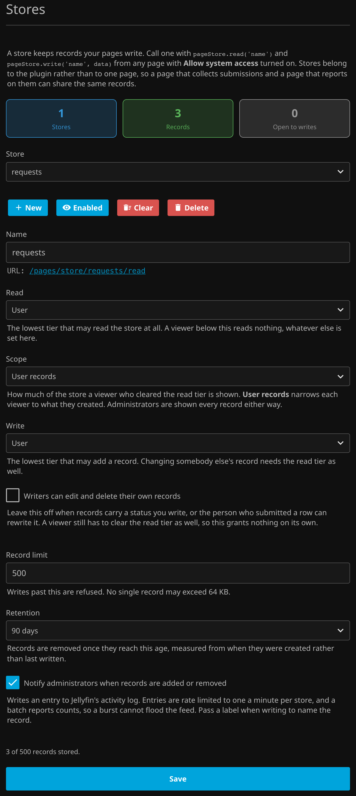

# Storing Data

A page can keep records on the server. Add a **store** on the **Stores** tab, give it a name, and any page with [Allow system access](SystemAccess.md) turned on can read and write it:

```js
pageStore.write('queue', { url: value })
  .then(function (record) { console.log(record.id); });

pageStore.read('queue')
  .then(function (records) { console.log(records); });
```

A store is a list of records. Everything except the payload is assigned by the server, so a page cannot forge an identity, a timestamp, or an owner on something it writes:

```json
{
  "id": "4752bb755ed34da79b118484d480288c",
  "createdUtc": "2026-09-07T04:03:33.6360120Z",
  "updatedUtc": "2026-09-07T04:03:44.3140730Z",
  "userId": "8f2c...",
  "data": { "url": "https://example.com/a", "status": "downloaded" }
}
```

The shape of `data` is entirely yours. The plugin never looks inside it.

The **Stores** tab with a store set up for the worked example below:



## Who Can Read and Who Can Write

A store belongs to the plugin rather than to one page, so a page that collects submissions and a page that reports on them can work against the same records. Access is decided by the store's own settings and never by which page is calling, which is what keeps one page from quietly widening another's audience.

* **Read** is the tier required to read the store at all. It is definitive. A viewer below it reads nothing, and no other setting can let them back in.
* **Scope** decides how much of the store a viewer who cleared that tier is shown. **All records** shows everything. **User records** narrows each viewer to the rows they created, which is what turns a store into a submission queue where people watch their own entry and nobody else's.
* **Write** is the tier that may add a record. It is independent of Read, so a write only drop box, one people submit to and nobody reads back, is a valid store.
* **Writers can edit and delete their own records** is off by default, so a record carrying a status an administrator wrote cannot be rewritten by the person who submitted it. It only applies to a store whose Scope is **User records**. See the warning below.

**Administrators are shown every record whatever Scope says**, the same way they are always admitted to a page restricted to specific users. That is what lets one store serve both halves of a workflow, and an administrator can read the store's file off disk regardless, so narrowing them here would only look like a restriction. Scope is therefore hidden on a store whose read tier is already **Admin**.

Changing a record needs both tiers. Write is what admits a caller to the store, and Read is what decides which records are theirs to touch, so a caller can never rewrite something the store would refuse to show them.

!!! warning "Scope All records lets every writer change every record"
    With **Scope** set to **All records**, anyone who clears both the Read and the Write tier can update and delete **any** record in the store, not only their own, and **Writers can edit and delete their own records** has no effect. On a store with Read and Write both set to **User**, any signed in user can rewrite or remove anybody's row. With both set to **Anyone**, so can somebody who never signed in. Use **User records** when submitters must not touch each other's rows, or keep Read or Write at **Admin**. The Stores tab shows this warning when a store is set up this way.

!!! warning "Anonymous writes"
    An anonymous caller owns nothing, so **User records** shows one an empty list rather than everything. If a store is open to anonymous writes, understand what that means: anybody who can reach your server can add records to it without signing in, and the record limit is the only thing bounding what they add.

## A Worked Example

To collect URLs from your users and track what happened to each one, make a store with **Read** set to **User**, **Scope** set to **User records**, and **Write** set to **User**.

A **User** tier page submits and shows the submitter their own queue:

```js
pageStore.write('queue', { url: input.value, status: 'queued' }, { label: input.value });
pageStore.read('queue').then(render);
```

A request page built this way, showing one user their own records:


An **Admin** tier page sees every submission and writes the outcome back onto one:

```js
pageStore.read('queue').then(render);
pageStore.write('queue', { url: row.data.url, status: 'done' }, { id: row.id });
```

The submitter watches their own row change status without ever seeing anyone else's, and cannot set the status themselves. The admin page needs no separate store, because Scope stops narrowing at the administrator. Whatever actually does the work can be a [server side route](SystemAccess.md#allow-local-resource-calls) the admin page calls, or something outside Jellyfin holding an API key.

## The Helper

`pageStore` is injected into any page running with **Allow system access**. It is a convenience and never a grant. Every call it makes is authorized on the server against the store's own tiers, so a page holding the helper reaches exactly the stores its viewer was already entitled to.

| Call | Does |
| --- | --- |
| `pageStore.read(name)` | Returns the records you may see, newest first. |
| `pageStore.read(name, id)` | Returns one record. |
| `pageStore.readAll(name)` | Returns the full response, including `count`, `limit`, and whether you were shown `all` records or only your `own`. |
| `pageStore.write(name, data)` | Creates a record and returns it. |
| `pageStore.write(name, data, id)` | Replaces that record's payload and returns it. |
| `pageStore.write(name, data, { id, label })` | Same, with the record's primary element. |
| `pageStore.remove(name, id)` | Deletes one record. |

Each returns a promise, and rejects with an `Error` carrying a `status` when the server refuses.

The same endpoints are reachable directly at `/pages/store/{name}/read`, `/write`, and `/delete` for anything calling from outside a page. A Jellyfin API key is treated as the administrator tier with no user identity, so a script or a background worker can pick work up and write results back, and can never own a record or benefit from the own record settings.

## Retention

A store keeps records permanently by default. Set **Retention** and records are removed once they reach that age, measured from when a record was created rather than when it was last written, so a status update from an administrator does not extend a submission's lifetime.

Retention is applied two ways so it always holds. Reading or writing a store drops its expired records first, which means a read can never return something the policy has already expired. A scheduled task, **Apply Custom Pages store retention**, runs every six hours for the stores nobody is touching, which would otherwise keep their last records forever whatever retention said. Expiring records also frees room against the record limit.

## Notifying Administrators

Turn on **Notify administrators when records are added or removed** and both write entries to Jellyfin's activity log, where the dashboard already surfaces plugin events. Clearing the store from the dashboard writes its own entry too, such as `12 records were cleared from queue`.

Pass a **label** when you write and the entry names the record instead of counting it:

```js
pageStore.write('queue', { url: value, status: 'queued' }, { label: 'Holiday photos' });
```

That reads as `Holiday photos was added to queue`, and the same label comes back as `Holiday photos was removed from queue` when the record is deleted, so the page only supplies it once. An update carrying no label keeps the one the record already has, since writing a status onto a record is not renaming it. Without a label the entry falls back to `A record was added to queue`.

Entries are rate limited to one a minute per store, and additions and removals share that window, so what an administrator gets is one line saying what happened rather than two racing each other. A batch reports counts, because it has no single thing to name: `4 items added to queue`, `3 items removed from queue`, or `4 items added and 3 items removed from queue`. The label is capped and flattened before it reaches the feed, so a page cannot write a line break into it.

## Limits and Storage

Every store caps how many records it holds, no single record's payload may exceed 64 KB, and a store holds at most 64 MB of payload in total. Writes past the record limit are refused with `409`, an oversized record with `413`, and a write that would take the store past its total size with `507`, rather than silently dropping the oldest row. An update that makes a record smaller is always accepted, so a store over its size can be trimmed back down. These caps apply to every store whatever its tiers, because they are the only thing bounding a store that accepts anonymous writes.

Records are kept as one JSON file per store under Jellyfin's data directory, at `data/custompages/stores/{name}.json`. They are data rather than settings, so unlike pages and assets they do **not** live in the plugin configuration and a configuration backup will not bring them back. Removing a store from the dashboard leaves its file alone, so recreating a store with the same name picks the old records back up. Use **Clear** when you actually want them gone.

If a store's file is ever unreadable, the store answers as empty and refuses every write rather than overwriting whatever the file holds. Repair or remove the file and restart Jellyfin.
